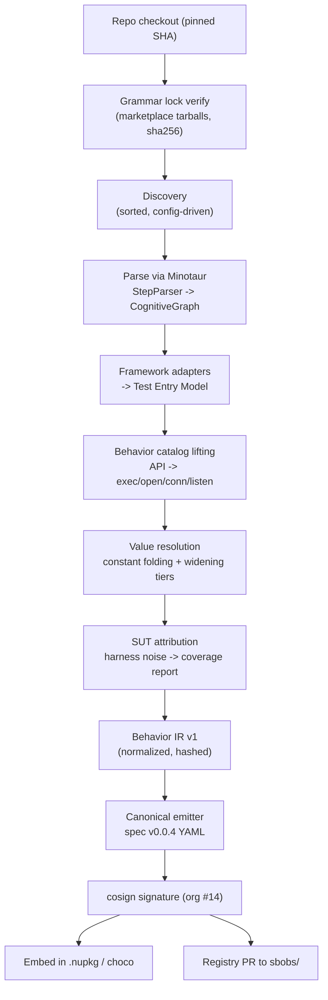
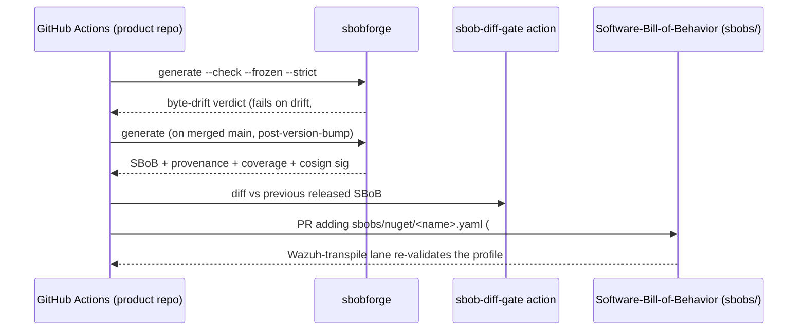

# SBOB-Forge — Tests → SBOB Generator

**Technical Design Specification**

**Version:** 1.0 · **Date:** 2026-10-31 · **Status:** Accepted (approved by Lars, 2026-10-31)
**Repository:** https://github.com/DevelApp-ai/SBOB-Forge (this document lives at `docs/TDS.md`)
**Author:** Detection Engineering (DevelApp)
**Source standard:** Software Bill of Behavior (SBOB), spec v0.0.4 ([spec](https://billofbehavior.com/bob/docs/spec/), [repo](https://github.com/k8sstormcenter/bob))
**Downstream consumer:** [Software-Bill-of-Behavior](https://github.com/DevelApp-ai/Software-Bill-of-Behavior) (SBoB → Wazuh/Kubescape transpiler)
**Parsing substrate:** [Minotaur](https://github.com/DevelApp-ai/Minotaur) + [Minotaur-Grammars](https://github.com/DevelApp-ai/Minotaur-Grammars)

---

## 1. Scope and objectives

### 1.1 Mission

Build a **deterministic static generator** that reads a package's test suite — across xUnit and every other test framework DevelApp ships — and emits a signed, spec v0.0.4-conformant **SBOB (ContainerProfile)** declaring the **packaged software's intended runtime behavior**. The generated SBOB is:

- **Embedded** in the `.nupkg` / Chocolatey package at build time,
- **Published** to the SBOB registry (`sbobs/` in the Software-Bill-of-Behavior repo),
- **Consumed** by the existing transpiler (`sbobctl transpile` → Wazuh drift rules) and, where the package is later containerized, by Kubescape node-agent.

The thesis: the bob project's own framing — *"a software vendor distills all their knowledge of their own testing into a standard file"* — is not a metaphor but a pipeline. Tests are the highest-signal, already-maintained corpus of intended behavior. If extraction from them is **static and canonical**, the SBOB becomes a *pure function of the source tree*: same code ⇒ byte-identical SBOB, rebuildable and drift-gateable in CI like any other generated artifact (org decision #26).

### 1.2 Positioning decision (resolved)

SBOB-Forge is a **standalone tool** that consumes Minotaur as NuGet packages. It is *not* a subpart of the Minotaur repo.

| Option | Verdict | Rationale |
|---|---|---|
| Subpart of Minotaur (`minotaur sbob …`) | **Rejected** | Violates Minotaur's architectural separation (StepParser owns parsing; plugins own unparsing/backend-rules only); couples security-tooling release cadence to the compiler-compiler platform; SBOB semantics (kernel-behavior lowering, widening policy, signing) are not grammar concerns. |
| Node/TypeScript tool next to the transpiler | **Rejected** | Would re-implement multi-language parsing without the Minotaur grammar estate; the transpiler stays a pure *consumer*. |
| **Standalone C# tool, consumes `DevelApp.Minotaur` + `DevelApp.StepParser` NuGet** | **Selected** | Reuses the cognitive-graph model, plugin manager, and grammar marketplace; SBOB-Forge owns only lifting/emission/signing; AGPL-3.0 (same as Minotaur, both DevelApp-owned). |

Dependency flow: `SBOB-Forge` → `DevelApp.Minotaur` (NuGet, GitHub Packages; CI auth via org secret `PACKAGES_READ_TOKEN`, decision #8) → grammars from Minotaur-Marketplace, **pinned** (§5.3).

### 1.3 Design principles

1. **Determinism from code.** The SBOB is a pure function of `(source tree at pinned SHA, grammar lock, generator version, config)`. No clock, no host paths, no unsorted enumeration, no environment-dependent widening. Byte-identical output in CI and on a laptop.
2. **Tests are intent; harness is noise.** Only behavior *of the packaged software* is declared. Test-framework machinery (assertions, temp fixtures, mock servers) is classified and excluded — but reported.
3. **Honest coverage.** What static extraction cannot lift (dynamic values, reflection, untested paths) is **never silently wildcarded**. It is quarantined into a coverage report; the SBOB uses spec §5.4 NULL/NONE semantics deliberately (§8.4).
4. **Package-bound profiles.** One SBOB per `(package, version, target-os)`, bound via `spec.imageID` = package purl (§4).
5. **One IR, many uses.** The behavior IR feeds SBOB emission today; the same IR can later feed the transpiler's IR directly, seccomp profiles, or SBOM `evidence` sections without re-parsing.
6. **Downstream compatibility is a contract.** Output MUST validate against the spec v0.0.4 JSON Schema (as implemented by the Software-Bill-of-Behavior validator) and round-trip through `sbobctl transpile`'s parse/validate/lint stages.

### 1.4 Phase plan

| Phase | Scope | Status |
|---|---|---|
| **1** (this document) | .NET/xUnit first, then Java, Python, Go, JS/TS, PHP, PowerShell, Bash, C, C++ adapters; NuGet + Chocolatey binding; embed + registry publish; cosign signing | Design |
| **2** | `rulePolicies` derivation (§15), endpoints section, dynamic-confirmation mode (optional CI lane that runs the suite under a trace and diffs against the static SBOB) | Outlined |
| **3** | Feedback loop: runtime drift findings from Wazuh filed back as test gaps ("behavior debt") | Outlined |

---

## 2. Background

### 2.1 The SBOB target model (spec v0.0.4)

A signed, declarative Kubernetes-style YAML resource (`kind: ContainerProfile`) bound to one workload via `spec.imageID` + pod label. Behavioral sections under `spec`:

| Section | Declares | Relevant to test-derived extraction |
|---|---|---|
| `execs[]` | permitted child processes: `path` + `args` (`⋯` one arg, `⋯⋯` zero-or-more args, `*` literal in args) | `Process.Start`, `exec.Command`, `subprocess`, `child_process`, shell calls |
| `opens[]` | permitted file opens: `path` + `flags` (`O_RDONLY`, `O_CREAT`, …) | file APIs — the largest catalog surface |
| `egress[]` | permitted outbound peers: `dnsNames[]`, `ipAddresses[]`, `ports[]` | HTTP clients, sockets, DNS resolution |
| `ingress[]` | permitted inbound peers (same shape) | server sockets, listeners |
| `capabilities[]` | Linux capabilities (`CAP_*`) | rarely test-derivable; Phase 2 (§15) |
| `endpoints[]` | HTTP endpoints (`:<port>/<path>`, methods, direction) | Phase 2 |
| `rulePolicies` | who may perform signature-class actions (module-load, namespace-change, …) | Phase 2; v1 leaves NULL |

**Wildcard semantics (spec §5)** — implemented exactly, since the transpiler lints against them: `⋯` (U+22EF, single codepoint) = one path segment; `*` mid-path = zero-or-more segments, trailing = one-or-more; `args` `*` is literal; DNS wildcards per RFC 4592 shapes; **absent (NULL) ≠ explicit-empty (NONE)** — NULL is engine-learn posture, NONE is declared-zero-activity with hard-violation semantics.

### 2.2 Test framework matrix (extraction scope)

| Language | Frameworks (priority) | Entry cues | Ignored-test cues |
|---|---|---|---|
| C#/.NET | **xUnit v2/v3 (primary)**, NUnit 3/4, MSTest v2/v3 | `[Fact]`, `[Theory]`, `[Test]`, `[TestMethod]` | `Skip=`, `[Ignore]`, `Assert.Skip` |
| Java | **JUnit 5**, JUnit 4, TestNG | `@Test`, `@ParameterizedTest` | `@Disabled`, `@Ignore`, `enabled=false` |
| Go | `testing` (stdlib) + testify | `func TestXxx(t *testing.T)` | `t.Skip`, `t.Skipf` |
| PHP | **PHPUnit 10/11** | `test*` methods, `#[Test]`, `@test` | `markTestSkipped`, `@requires` |
| Python | **pytest**, unittest | `test_*` functions/methods | `@pytest.mark.skip`, `@unittest.skip`, `xfail` |
| JavaScript | **Jest**, Mocha, node:test | `describe/it/test` | `.skip`, `xit`, `xdescribe` |
| TypeScript | **Jest**, Vitest | same as JS | same as JS |
| PowerShell | **Pester v5** | `Describe`/`It` | `-Skip` |
| Bash | **Bats** (bats-core) | `@test`, `bats` files | `skip` |
| C | GoogleTest, Unity, CMocka | `TEST()`, `RUN_TEST` | `GTEST_SKIP`, disabled fixtures |
| C++ | **GoogleTest**, Catch2 v3, doctest | `TEST()`, `TEST_CASE` | `SKIP()`, `[!mayfail]` |

Ignored tests are **excluded** from intent but **reported** in the coverage manifest ("tested-no-longer" behavior).

### 2.3 Grammar estate (Minotaur-Grammars inventory)

Present today: `csharp10`, `java/java17/java8`, `go119`, `php`, `python311`, `javascript(-es2022)`, `typescript`, `c17`, `cpp20`, `powershell`, `bash`, plus Ruby/Rust/Perl and others. The `powershell`/`bash` gap is closed (§5.4 Phase B, 2026-11-01): the grammars are authored and committed to Minotaur-Grammars (the repo is the single home; marketplace distribution keeps the tool lean) and sha256-pinned via embedded byte-identical copies, while the parsers remain in-repo backends. M5 note (2026-11-01): although Minotaur-Grammars carries `c17`/`cpp20` grammars, M5 ships built-in deterministic C/C++ backends instead (§5.2 M5 note) — the M1 probe showed the public Minotaur package does not yet expose structure-preserving parsing, so in-repo backends keep `--frozen` verification self-contained; the swap path applies unchanged when it does.

---

## 3. System architecture

### 3.1 Pipeline overview



### 3.2 Components

| Component | Form | Responsibility |
|---|---|---|
| `sbobforge` | .NET CLI tool (`DevelApp.SBOBForge`, `dotnet tool install`) | End-to-end pipeline; subcommands §13 |
| Discovery | C# module | Deterministic file/test enumeration from `sbobforge.json` globs |
| Minotaur integration | Reference to `DevelApp.Minotaur` / `DevelApp.StepParser` | `StepParserIntegration.ParseToCognitiveGraphAsync`, `LanguagePluginManager.GetPluginByExtension`, CognitiveGraph V2 for large repos |
| Framework adapters | One class per framework, registry pattern (M-E-F-free; fixed table) | Test-entry identification, skip-filter, SUT-call collection |
| Behavior catalog | Declarative data (JSON embedded in tool, versioned) | API → SBOB primitive lowering (§7) |
| Behavior IR | C# types, versioned (`sbobIrVersion: 1`) | Language-neutral event model + provenance |
| Canonical emitter | C# module | Byte-stable YAML per §8 |
| Coverage report | JSON sidecar | Lift/quarantine/noise inventory, per entry provenance |
| Provenance sidecar | JSONL | entry → (file:line, test id, tier, grammar version) map for `explain` |
| CI wiring | Composite action + product-repo workflows | `--check` drift gate (#26), embedding, registry PR, signing |

### 3.3 Repository layout

```
SBOB-Forge/
├── src/
│   ├── SBOBForge/               # CLI, pipeline orchestration
│   ├── SBOBForge.Core/          # IR, emitter, resolution, hashing
│   ├── SBOBForge.Catalog/       # behavior catalog data + loader
│   ├── SBOBForge.Adapters.*/    # per-language/framework adapter projects
│   └── SBOBForge.Tests/         # unit + golden + equivalence corpus tests
├── catalog/                     # language catalog source (JSON), committed
├── examples/                    # dogfood fixtures per language
└── docs/TDS.md                  # this document
```

Generated SBOBs live in **each product repo** at `sbob/<package>.<target-os>.sbob.yaml` (committed, authoritative, drift-gated per #26), mirrored to the central registry.

---

## 4. Binding model: `imageID` = package purl

**Decision:** the SBOB binds to the *package identity*, expressed as a [purl](https://github.com/package-url/purl-spec) in `spec.imageID`:

| Package type | `spec.imageID` |
|---|---|
| NuGet | `pkg:nuget/develapp.minotaur@1.32.0` |
| Chocolatey | `pkg:choco/<lowercased-id>@<version>` (org extension; `choco` is not a core purl type) |

Rules:

- The purl is fully normalized at emission: lowercase name, version = the exact package version (no ranges), no qualifiers except `?repository_url=` when consuming from a private feed (emitted only behind a config flag, since it harms reproducibility across mirrors).
- `metadata.name` = purl name with `.` → `-` (`develapp-minotaur`); `metadata.namespace` = product line (`develapp`); `kubescape.io/managed-by: User` + `develapp.io/binding: package-purl` annotations mark provenance so a learned-profile collector never garbage-collects it (mirrors upstream user-profile convention).
- **Conformance note:** spec v0.0.4 §4.1 says `imageID` is an OCI image reference "ideally pinned by digest". A purl is a deliberate, documented deviation. Because verifiers bind via label (`kubescape.io/user-defined-profile: <metadata.name>`) and the binding is name-based, this works operationally; the transpiler's validator needs a one-line `imageID` pattern extension (tracked as a Software-Bill-of-Behavior issue). Upstream contribution of a `package-profile` variant is an open-issue candidate with the bob project (§16).
- **Container composition path:** when a package is later baked into an image, CI runs `sbobforge generate --image <ref@digest>` in that image's repo; the test-derived sections are reused from the package profile and re-bound to the real image ID. The package profile remains the canonical intent record.

`--target-os` selects path policy per profile: `linux` (default for NuGet — org platform is Talos, decision #9) and `windows` (default for Chocolatey). One document per `(package, target-os)`; `spec.architectures` reflects the package's RID set where applicable.

---

## 5. Discovery and parsing layer

### 5.1 Discovery

- Input: `sbobforge.json` in the package repo root: package purl, SUT project/file globs, test globs, framework toggles, path policies (§7.3), target-os set.
- Enumeration is **strictly ordered**: walk entries sorted by ordinal UTF-16 string comparison of normalized relative paths; no `Directory.Enumerate*` unordered APIs; results are a stable list. CI runners with different filesystems produce identical discovery output.

### 5.2 Parsing

- Each discovered file is parsed via Minotaur into a CognitiveGraph (`ParserConfiguration.GraphVersion = V2` above size thresholds — deterministic given fixed thresholds; the thresholds are constants, not tunables, so graph shape is stable).
- Language selection: `GetPluginByExtension`; embedded languages (JS-in-HTML, etc.) via Minotaur's embedded-grammar support.
- Parse failures are **hard errors** (exit 2), never best-effort skips: a file that cannot be parsed could hide behavior, so the tool refuses to emit a silently incomplete SBOB. `--allow-parse-error <path>` exists for vendored fixtures, recorded in the coverage report.

#### Implementation note (M1, 2026-10-31)

A probe of the public `DevelApp.Minotaur` 1.5.0 package (nuget.org) showed that `StepParserIntegration.ParseToCognitiveGraphAsync` currently yields a flat token stream **without punctuation tokens** (no braces/parentheses) and truncates on non-trivial inputs, so syntax structure cannot be reconstructed for IR extraction at M1. `ValidateSourceAsync` works and is retained.

**M1 decision:** the C# structural backend is Roslyn (`Microsoft.CodeAnalysis.CSharp` 4.11.0), pinned via the lock as `grammars["csharp"]`; `DevelApp.Minotaur` stays the pinned source-validation substrate (1.5.0 at M1; bumped to 1.5.25 from the GitHub Packages feed in the M5 Phase B follow-up — 1.5.23+ is not published to nuget.org, whose flatcontainer tops out at 1.5.0), and `generate --frozen` verifies both. The `ICodeModelParser`/`CodeModel` seam is backend-agnostic: when a public Minotaur release supports structure-preserving CognitiveGraph parsing, the Roslyn backend is swapped for a Minotaur-backed backend with no IR, catalog, adapter, or emitter changes. The lock additionally pins the .NET behavior catalog via `grammars["dotnet-catalog"].sha256`.

#### Implementation note (M2, 2026-10-31)

Minotaur has no public Java or Python grammars yet (the Minotaur-Grammars marketplace is C#-only at 1.5.0), so M2 ships **built-in deterministic backends** for Java 17 (`sbobforge-java17`) and Python 3.11 (`sbobforge-python311`) — self-contained tokenizer + parser passes inside SBOBForge.Parsing, no JDK/CPython toolchain dependency. Parse failures remain hard errors (exit 2); mixed tab/space indentation and bad dedents in Python are hard errors by design. Both backends are pinned via the lock (`grammars["java17"]`, `grammars["python311"]`) and `generate --frozen` verifies them together with the pinned catalog hashes (`java-catalog`, `python-catalog`). The same backend-agnostic `ICodeModelParser`/`CodeModel` seam applies: when Minotaur ships Java/Python grammars, the built-in backends are swapped with no IR, catalog, adapter, or emitter changes.

**M2 dogfood decision — argv0-anchoring (resolves open issue 4):** dogfooding the generator against a real DevelApp Python suite (storytime-audiobook-studio) showed that full quarantine of partially-parameterized argv (`["git", "-C", str(d), "pull"]`) drops every exec in the profile — real apps routinely interpolate one dynamic path into an otherwise-literal argv. Freezing the policy as **argv0-anchoring**: when argv[0] is a constant literal and later elements are dynamic, the exec lifts as `args: [argv0, ⋯⋯]` (tier: the argv0 tier, program via `execPathPolicy`); when argv[0] itself is dynamic, the exec quarantines (a program that cannot be named cannot be policy-mapped). Fully-literal argv keeps exact `args` (no wildcard). Implemented for the Python and Java backends (`ArgKind.PartialList`); the same quarantines-as-before semantics apply elsewhere. Relatedly, when the emitter refuses to emit a section-shadowed profile (§8.4), the coverage report is now written anyway so there is something to inspect.

#### Implementation note (M3, 2026-11-01)

M3 extends the M2 approach to Go and JS/TS with built-in deterministic backends: Go 1.19 (`sbobforge-go119`) and a unified JavaScript/TypeScript backend (`sbobforge-typescript`, covering `.js/.mjs/.cjs/.ts/.tsx/.jsx`), plus pinned `go-catalog` and `js-catalog` behavior catalogs — same backend-agnostic `ICodeModelParser`/`CodeModel` seam and swap path as M2. Parse failures remain hard errors (exit 2).

**Go:** all top-level funcs (receiver or plain) are methods of one package pseudo-type, so provenance reads `sut:<pkg>.<Func>`; the entry cue is the `go test` naming convention (`func TestXxx(t *testing.T)`), with `t.Skip`/`t.Skipf` body calls disabling the entry. `os.OpenFile` flag masks (`os.O_WRONLY|os.O_CREATE|…`) pre-map to a canonical flag-mask identifier and lower to spec open(2) flag tokens in canonical order; unknown flag constants quarantine. `net.Dial`/`net.Listen` accept literal `host:port`/`:port` addresses (`udp*` → UDP); IPv6 literal addresses are not resolvable in v1 and quarantine.

**JS/TS:** the parser synthesizes one `js.entry`-attributed method per `it`/`test` call (named args: `title`, `full` describe path, `state`, `skipIf`, optional `cases` for `.each`), with callback parameters becoming method parameters so M1 case-value substitution works. The Jest adapter owns the unconditional surface (`.skip`, `xit`/`xtest`, `.each` case propagation; `.only` is a runner filter, not a skip) and the Vitest adapter owns `.skipIf` entries with unittest skipIf semantics (`skipIf(true)` → disabled; anything else → enabled). Catalog receiver semantics: an empty-string receiver matches only bare calls (destructured `execFile`/`fetch`), keeping `RegExp.prototype.exec` and lodash-style false matches out; `spawn`/`execFile` use argv0-anchoring for dynamic args (§5.2).

**Limitations (documented, honest):** describe-body statements outside entries/hooks are not modeled (same posture as Python module-level statements); hook callbacks (`beforeEach` …) surface as attribute-less helpers whose invocations appear as coverage noise; regex literals use the classic expression-position heuristic; TS type syntax is tolerated and skipped, not modeled; Go method values on declared types are not modeled in v1 (receiver funcs are package methods).

#### Implementation note (M5, 2026-11-01)

M5 ships built-in deterministic C/C++ backends, `sbobforge-c17` and `sbobforge-cpp20` (shared `CxxParserCore`; `.c/.h` → C, `.cc/.cpp/.cxx/.hpp/.hh/.hxx` → C++), pinned via the lock as `grammars["c17"]`/`grammars["cpp20"]` together with `c-catalog`/`cpp-catalog` — same backend-agnostic `ICodeModelParser`/`CodeModel` seam and swap path as M2–M4. The tokenizer treats preprocessor directives as single line-granular tokens (`#include` → Imports; the preprocessor is *not expanded*), handles raw string literals `R"delim(…)delim"` and `L/u/U/u8` prefixes, and parse failures remain hard errors (exit 2).

**Test macros:** `TEST`/`TEST_F`/`TEST_P`/`TYPED_TEST`/`TEST_CASE`/`TEST_CASE_METHOD`/`METHOD_AS_TEST_CASE`/`TEMPLATE_TEST_CASE` blocks become `cxx.entry`-attributed methods in a `<cxx-tests>` pseudo-type. **The method name is unique per macro instance (`macro#argCount@line`)** — the pipeline matches entries to method bodies by name, so a shared name would conflate every test body and leak disabled-entry events through the enabled entries (found via the M5 fixture goldens). Disable cues: `GTEST_SKIP()`/`SKIP()` (GoogleTest/Catch2), `TEST_IGNORE()` (Unity); Unity free-function `test_*` entries count only when registered by a same-file `RUN_TEST`/`RUN_TEST_CASE` invocation. TestId forms: GoogleTest `relpath::Suite.Name`, Catch2 `relpath::Title`, Unity `relpath::test_name`.

**SUT model:** C functions are methods of `<global>` (provenance `sut:<global>.func`); C++ namespaces/classes map to Namespace/DeclaringType (qualified call receivers are the `::`-chain prefix, `std::filesystem::remove_all` → receiver `std::filesystem`; namespace aliases resolve via first-segment lookup). Construction forms are tracked: `std::ifstream f("p")` → invocation `std::ifstream("p")`, later `f.open("p")` → receiver `std::ifstream`. **Socket hoisting (documented decision):** `x.sin_port = htons(N)` / `x.sin_addr.s_addr = inet_addr("host")` attach named host/port args to the subsequent `connect()`/`listen()` in the same body — only this pattern is modeled; no IPv6 in v1.

**Catalog lowering:** `execve`/`execvp` argv masks lower to exact argv (List of literals) or argv0-anchor (PartialList, §5.2 M2 policy); both-dynamic → quarantine. `system`/`popen` reuse the shell lowering (`/bin/sh -c`). `fopen` reuses the mode table; POSIX `open` lowers `O_*` masks in canonical order (unknown constants quarantine); `creat`/`mkdir`/`create_directory` → `O_DIRECTORY|O_CREAT`. `std::ifstream` → `O_RDONLY`; `std::ofstream` → `O_WRONLY|O_CREAT` plus `O_APPEND` (`ios::app`) or `O_TRUNC`; `std::fstream` `in|out` → `O_RDWR`; unresolvable modifiers (`ios::ate`) quarantine. `getaddrinfo` lowers host + numeric service to egress (service names quarantine); `connect`/`listen` require the hoisted named args. `unlink`/`remove`/`remove_all` → delete (unrepresentable).

**Limitations (documented, honest):** the preprocessor is not expanded (macros that generate calls are invisible); C++ templates are not instantiated; `std::ios::ate`/seek-based modes are unresolvable and quarantine; socket hoisting covers only the `htons`/`inet_addr` field-assignment pattern (no IPv6); GoogleTest/Catch2 value-parameterized case arguments are not bound (no theory-case substitution); non-test free functions in test files are harness noise (same posture as M3 helpers). PowerShell/Bash authored grammars are pinned and the lexical adapters retired in the Phase B follow-up (§5.4).

### 5.3 Grammar lock

`sbobforge.lock.json`, committed in each product repo:

```json
{
  "sbobIrVersion": 1,
  "grammars": {
    "csharp10":  { "version": "1.19.0", "sha256": "…" },
    "java17":    { "version": "1.14.2", "sha256": "…" },
    "typescript":{ "version": "1.9.1",  "sha256": "…" }
  },
  "minotaur": { "version": "1.32.0" }
}
```

- `generate --frozen` (required in CI): fails if the installed grammar set ≠ lock, or any tarball sha256 mismatches. Grammars resolve from Minotaur-Marketplace; the lock file is updated only by `sbobforge lock --update`, reviewed like any dependency bump (PR-only, decision #28).
- The lock's sha256 feeds the `develapp.io/grammar-lock-sha256` annotation, so a verifier can tell *why* two SBOBs of the same code differ.

### 5.4 PowerShell and Bash (grammar gap)

- **Phase A (M4):** deterministic lexical adapters — a fixed token scanner (not regex-over-the-world) recognizing the catalog's call shapes (`Start-Process`, `&`, `Invoke-WebRequest`, `Get-Content` / `curl`, `wget`, `nc`, redirections). Marked `parser: lexical` in the coverage report; the SBOB annotations record it, so consumers know the confidence tier.
- **Phase B (M5+, completed 2026-11-01):** the `powershell` and `bash` grammars are authored and merged in Minotaur-Grammars (PR #196). Byte-identical copies are embedded in `SBOBForge.Parsing` and sha256-pinned in the lock (`grammar-lock-sha256` is verifiable under `--frozen` with no network fetch). `sbobforge-powershell`/`sbobforge-bash` (v2.0.0) are structural statement scanners built in-repo — same posture as the M5 C/C++ backends (§5.2 M5 note): the public Minotaur package still does not expose structure-preserving parsing, so the swap path stays open (§5.2) while `--frozen` verification remains self-contained. The Phase A lexical markers (`LexicalParsers` in the coverage report, `develapp.io/parser: lexical` in the annotations) are deleted.

#### Implementation note (M4, 2026-11-01)

M4 delivers Phase A plus a structural PHP backend. PHP is a deterministic structural parser (`sbobforge-php`): namespaces/classes/methods, docblock attributes (`@test`, `@requires`), `#[Test]` attributes, `$this->` / `Class::` receiver chains, and a `php-catalog` (fopen mode table, `file_get_contents` dual open/URL kind, `file_put_contents`, mkdir, unlink/rmdir deletes, the `exec` family as literal-first-token execTokens, `curl_init` egress). PowerShell (`sbobforge-powershell`) and Bash (`sbobforge-bash`) are the fixed lexical scanners described above, pinned as lock grammars `powershell`/`bash` with `powershell-catalog`/`bash-catalog` — same `ICodeModelParser`/`CodeModel` seam and Phase B swap path as the M2/M3 backends. Pester v5 `Describe`/`Context`/`It [-Skip]` blocks synthesize `ps.entry` methods (named args title/full/state); Bats `@test "title" { … }` blocks synthesize `sh.entry` methods with a body `skip` disabling the entry. The `parser: lexical` marker was emitted in two places: the coverage report gained a `LexicalParsers` list (only non-empty for lexical backends), and the SBOB annotations carried `develapp.io/parser: lexical` only when the list is non-empty. Both markers were retired in Phase B (below).

#### Implementation note (Phase B, 2026-11-01)

Phase B keeps the M4 tokenizers and command-argument engines (battle-tested by the fixture goldens) and replaces the statement-pooling walk with a structural driver on top. `sbobforge-powershell`/`sbobforge-bash` (v2.0.0, BackendIds unchanged) now model: PowerShell `function`/`filter`/`workflow`/`class`/`enum` declarations, `param(…)` blocks as method parameter lists, `if`/`elseif`/`else`, `switch` cases, `foreach`/`for`/`while`/`do`, `try`/`catch`/`finally`/`trap`, here-strings and backtick line continuations; Bash `function` definitions (recursively at any depth), `if`/`elif`/`else`/`fi`, `while`/`until`, `for`/`select`, `case`/`esac`, `[[ ]]`/`[ ]` tests (skipped, no invocation), heredocs/herestrings, fd-redirect normalization (`2>` behaves as `>`, `2>&1` fd-merges emit no event), and the `&&`/`||`/`;;` operator set. The grammar-lock sha256 pins are backed by the embedded grammar copies (`GrammarResource.Sha256`), so `--frozen` verifies them offline. The lock's Minotaur substrate is pinned to 1.5.25 (GitHub Packages feed; 1.5.23/1.5.24/1.5.25 are not published to nuget.org, whose flatcontainer still tops out at 1.5.0); the structural-parsing swap (§5.2) remains deferred and is unchanged by this bump.

**Limitations (documented, honest):** PowerShell `param(…)` blocks are modeled parameter lists since Phase B (statements in `Describe` bodies outside `It` blocks land in a `<script>` helper and surface as harness noise rows); `curl_setopt` is not modeled (only `curl_init`'s URL literal lifts); PHP `file_put_contents` FILE_APPEND flag is not modeled (defaults to O_TRUNC); Bash input redirection (`<`) is not modeled; command substitutions (`$(…)`, backticks) are opaque expression tokens whose contents are not scanned; no IPv6 address literals (quarantine).

---

## 6. Framework adapter contract

Every adapter (one per framework) implements:

```
1. IdentifyTestEntries(graph) -> TestEntry[]
     { testId, file, enabled, entryMethod, classChain, theoryCases }
2. CollectHarnessCalls(testEntry) -> classified set
     { assert, fixture, tempArtifact, frameworkService }
3. CollectSutCalls(testEntry) -> InvocationSite[]
     { callTarget, arguments, file, line, resolvesToSut: bool }
```

- **testId** is canonical: `"<relpath>::<Class>::<Method>[::<case>>"` — stable across machines, used by the provenance sidecar.
- **Theory/parameterized tests**: each case is a separate TestEntry (cases are part of intent); case values participate in constant folding (a `[InlineData("/etc/app/config.json")]` gives a Tier-L literal).
- **Skip-filter**: disabled tests are excluded from intent; their behavior model diff is listed in the coverage report as `retired` (if it had contributed in the previous committed SBOB, `--check` mode surfaces it — a deliberate SBOB change, reviewed in the PR).
- **Fixture/setup code** (`[SetUp]`, `beforeEach`, `setup()`, `-BeforeEach`) lifts like test bodies: setup is intent-bearing (a server fixture that binds a port *is* SUT behavior when the fixture drives the SUT's listen API; it is harness noise when it only arranges test files — resolution per §7.4 attribution).

---

## 7. Behavior catalog (API → SBOB lowering)

### 7.1 Catalog shape

Declarative JSON, one file per language, committed and versioned with the tool:

```
match:    { kind: methodCall|functionCall|operator, languageType, method,
            argumentSlots }
lower:    { primitive: exec|open|connect|listen|delete|dns,
            pathSlot, flagsFrom, hostSlot, portSlot }
scope:    { sutOnly | harness | ambiguous }
```

### 7.2 Core lowering tables (representative, not exhaustive)

**Exec:**

| Language | API | → `execs[]` |
|---|---|---|
| C# | `Process.Start`/`ProcessStartInfo.FileName/.Arguments` | `path` + `args` vector (argv0 anchored) |
| Java | `Runtime.exec`, `ProcessBuilder(...)` | `path` + `args` |
| Go | `exec.Command(name, args...)` | `path` (PATH-resolved per policy §7.3), `args` |
| Python | `subprocess.*`, `os.system` (shell → `/bin/sh -c …`) | `path`, `args`; `shell=True` lowers to `/bin/sh` + `-c` + literal arg or quarantine |
| JS/TS | `child_process.spawn/exec/execFile` | `path`; `exec` lowers via `/bin/sh` |
| PHP | `exec`, `shell_exec`, `proc_open`, `popen` | shell-mediated; literal first token → PATH policy |
| PowerShell | `Start-Process`, call operator `&`, `Invoke-Expression` | `path`/`args`; `Invoke-Expression` with non-constant arg = quarantine (RCE-shaped, must be reviewed) |
| Bash | command words | first word via PATH policy |
| C | `execve`, `execvp`, `system`, `popen` | direct / shell-mediated |
| C++ | `std::system`, `popen`, `fork+exec` | direct |

**Open (flags mapping):**

| API form | `flags[]` |
|---|---|
| read (`FileMode.Open`+`FileAccess.Read`, `open(r)`, `fopen("r")`, `os.Open`, `Get-Content`, `fs.readFile*`, `ifstream`) | `[O_RDONLY]` |
| write-truncate (`FileMode.Create`, `"w"`, `os.Create`, `Set-Content`, `fs.writeFile*`) | `[O_WRONLY, O_CREAT, O_TRUNC]` |
| append (`FileMode.Append`, `"a"`, `O_APPEND` forms, `Add-Content`) | `[O_WRONLY, O_CREAT, O_APPEND]` |
| read-write (`"r+"`, `FileAccess.ReadWrite`, `O_RDWR` forms) | `[O_RDWR]` |
| directory ops (`Directory.Create*`, `mkdir`, `New-Item -ItemType Directory`) | `[O_DIRECTORY, O_CREAT]` entry on the directory path |
| delete (`File.Delete`, `os.Remove`, `unlink`, `rm`) | **not representable in v0.0.4 `opens`** → recorded in coverage report as `unrepresentable: delete` (§15) |

**Network:**

| Language | API | → section |
|---|---|---|
| C# | `HttpClient`/`WebRequest` with constant `Uri` | `egress[].dnsNames[]` + `ports[]` (scheme default: 80/443; explicit port kept) |
| Java | `HttpClient`, `HttpURLConnection`, `Socket(host, port)` | egress dns/ip + ports |
| Go | `net.Dial`/`http.Get` | egress; `net.Listen` → `ingress[].ports[]` |
| Python | `requests.*`, `urllib`, `http.client`, `socket.create_connection` | egress |
| JS/TS | `fetch`, `http/https.request`, `net/tls.connect`; server: `net.Server.listen`, `createServer.listen` | egress / ingress |
| PHP | `curl_*`, `file_get_contents("http…")`, streams | egress |
| PowerShell | `Invoke-WebRequest`, `Invoke-RestMethod`, `TcpClient` | egress |
| Bash | `curl`, `wget`, `nc`, `ssh` | egress (`ssh` also candidate rulePolicy, Phase 2) |
| C/C++ | `connect(2)` with constant `sockaddr`, `getaddrinfo` with constant host; `listen(2)` | egress / ingress |

DNS constants: lowercase, IDN → punycode (deterministic IDNA2008), FQDN trailing dot per spec recommendation.

### 7.3 Path policy (the Windows↔POSIX seam)

Test code is full of host-shaped paths (`Path.GetTempPath()`, `./testfixtures/…`, `C:\…`). Tests run anywhere; the SBOB describes a *deployment*. Resolution tiers:

| Tier | Condition | Emission |
|---|---|---|
| **L (literal)** | Argument constant-folds to an absolute path/URL literal **inside SUT code** (not the test) | Literal entry |
| **P (pattern)** | Value depends on a *declared placeholder*: package root, config dir, data dir, temp dir — per `pathPolicies` in `sbobforge.json` | Mapped wildcard entry, e.g. package root → `/app/⋯`, config → `/etc/<name>/⋯` |
| **Q (quarantine)** | Cannot be resolved statically (env vars, reflection, `Path.Combine(temp, …)`, non-constant `Invoke-Expression`) | **No SBOB entry.** Coverage-report row with provenance. `--strict` fails the build on Q>0; default is warn. |

`--target-os windows` keeps Windows-native absolute paths (`C:\ProgramData\…`) — consumed by the transpiler's Windows/Sysmon lane; `--target-os linux` applies the POSIX policies above. The mapping table itself is config data committed in the repo, so it is reviewed like code and stable per target.

### 7.4 SUT attribution

- The **SUT boundary** = the projects/files that the packaging step ships (csproj → nupkg contents; choco `tools/` payload), declared in `sbobforge.json`.
- A lifted behavior event counts as intent **iff its call site resolves into the SUT boundary**, reached from an enabled test entry through the call graph over the CognitiveGraph (bounded, deterministic traversal: sorted worklist, memoized).
- Calls made by the test itself directly against the OS (e.g., the test spawns a docker-compose container) are `harness` — excluded from sections, listed in the coverage report as `test-harness noise`, because at runtime nobody will execute the test suite.
- Mocks/stubs never lower: they call no OS APIs on the SUT's behalf. If a test mocks *away* a real dependency (e.g., mocks the HTTP client), the SUT's outbound behavior is **under-declared** — flagged in the coverage report as `mock-shadowed: egress`, a leading false-positive source downstream. (This is the honest-coverage principle: better a visible warning than a silent hole.)
- Reflection / dynamic dispatch / plugin loading (`RuntimePluggableClassFactory`-style factories, DI, `Assembly.Load`): the call graph edge is unresolved → affected targets go to quarantine with the reason; scanning the DI registration table (a fixed, well-known pattern set) recovers the common case deterministically.

---

## 8. Emission: canonical SBOB output

### 8.1 Deterministic canonicalization

- YAML emitted by a hand-rolled writer (no YAML library object-graph traversal, which is unordered by nature): fixed section order `capabilities, endpoints, execs, opens, ingress, egress, rulePolicies`; fixed field order per entry; LF line endings; 2-space indent; block style; **no anchors/aliases/tags**; every list sorted by total-order key (`path` ordinal asc, then `flags` lexicographic; `args` as tuple compare).
- `⋯` is always the single codepoint U+22EF — never `...` (a three-dot run MUST be rejected by the emitter's self-lint, mirroring `bobctl validate` behavior).
- Sections with no lifted entries are **omitted** (NULL semantics — engine-learn posture per §5.4).
- **NONE (`[]`) is never auto-generated.** Declaring zero-activity is a human assertion; the tool refuses to invent it. `--declare-empty <section>` exists behind explicit config with a required comment string, recorded in the coverage report.

### 8.2 Example (illustrative)

```yaml
apiVersion: spdx.softwarecomposition.kubescape.io/v1beta1
kind: ContainerProfile
metadata:
  name: develapp-minotaur
  namespace: develapp
  annotations:
    kubescape.io/managed-by: User
    develapp.io/binding: package-purl
    develapp.io/generator: sbobforge@1.0.0
    develapp.io/grammar-lock-sha256: 9f2c41…
    develapp.io/behavior-hash: 4a71b0…
spec:
  architectures: [amd64, arm64]
  imageID: pkg:nuget/develapp.minotaur@1.32.0
  execs:
    - path: /usr/share/dotnet/dotnet
      args: [dotnet, "⋯⋯"]
  opens:
    - path: /usr/lib/dotnet/⋯/*
      flags: [O_RDONLY]
  ingress:
    - identifier: minotaur-evidence
      type: external
      ports:
        - { port: 8080, protocol: TCP }
```

### 8.3 Provenance and hashing

- `develapp.io/behavior-hash` = sha256 over the **normalized IR** (not the YAML text): version tag, sorted event tuples with tiers, grammar-lock hash, config hash. Two runs over the same tree can only differ if one of those changed — the hash makes the difference attributable.
- Provenance sidecar (`sbob/<package>.provenance.jsonl`): one record per emitted entry — `testId`s, file:line, tier, grammar, catalog rule id. Powers `sbobforge explain /etc/ld.so.cache` → "opened in Minotaur.Parser.DynamicLinkerProbe, exercised by 12 xUnit facts; Tier L".

### 8.4 Deliberate defaults table

| Situation | Emission posture |
|---|---|
| No tests lift any behavior for a section | Section omitted (NULL) |
| Every candidate entry quarantined | Section omitted + coverage report `section-shadowed` warning (downstream drift will be noisy — surface it) |
| Skipped test previously contributed entries | `--check` diff shows removal; PR review decides re-add vs retire |
| Unrepresentable primitives (delete, chmod, symlink, rename) | Coverage report only (§15) |
| `rulePolicies` | Omitted in v1 (NULL). Nothing in a test suite of the supported frameworks statically evidences kernel signature-class behavior at this tier. |

---

## 9. Determinism contract

**Definition:** for pinned `(source SHA, sbobforge.json, sbobforge.lock.json, tool version, --target-os)`, output is byte-identical on any machine, any filesystem, any CI runner, any time.

| Nondeterminism source | Mitigation |
|---|---|
| Filesystem enumeration order | Ordinal-sorted discovery (§5.1) |
| Clock | No timestamps in output; `behavior-hash` is content-derived; registry PR carries the version from the package, not from generation time |
| Host paths | Repo-relative provenance only; output paths come from policies/literals, never `Directory.GetCurrentDirectory` |
| Culture | `Ordinal`/`OrdinalIgnoreCase` comparisons everywhere; invariant culture for formatting; static analysis flags `ToLower()` culture usages in code review |
| YAML library ordering | Hand-rolled canonical writer (§8.1) |
| Grammar versions | Lock file + `--frozen` + sha256 (§5.3) |
| HashMap iteration | All aggregation steps sort before emission; analyzer rule forbids `Dictionary` iteration in emission path |
| PATH resolution of exec names | Never resolved against the *host* PATH; a committed `execPathPolicy` table maps bare names (`dotnet`, `sh`, `git`) to declared runtime locations; unknown names → quarantine |
| CognitiveGraph V1/V2 auto-selection | Auto thresholds are fixed constants; selected version recorded in provenance |

Enforcement (org decision #26):

1. **Golden-file tests** in SBOB-Forge CI: every fixture repo in `examples/` regenerates byte-identical SBOBs.
2. **Product-repo drift gate**: CI runs `sbobforge generate --check --frozen --strict`; byte drift against the committed `sbob/*.sbob.yaml` fails the build; the fix is re-running the generator, never hand-editing (exact #26 wording).
3. **Cross-language equivalence corpus**: the same behavioral program expressed in every supported language/framework must yield identical `execs/opens/egress` sections — this is the strongest guard against language-adapter drift.

---

## 10. Validation, signing, distribution

### 10.1 Validation lane (CI)

1. `sbobforge validate` — structural validation equivalent to spec v0.0.4 JSON Schema (+ purl `imageID` extension), self-lint for `⋯` misuse, arg-wildcard legality.
2. Cross-validation with the **Software-Bill-of-Behavior** transpiler: CI checks out that repo at a pinned SHA and runs its parse/validate/lint stages over the emitted SBOB (Node ≥ 22 per org decision #20). The committed fixture goldens are kubescape-dialect; the `transpiler-replay` CI job first converts each with `sbobforge convert` (§10.4) and then runs `sbobctl validate` over the registry-dialect copy. If the transpiler's lint policy caps reject an entry (e.g. wildcard breadth), the failure routes here, not downstream.
3. `bobctl validate` (upstream, when available for the pinned release) as a tertiary conformance check.

### 10.2 Signing

- cosign, per org decision #14 (images and artifacts are cosign-signed; same key/identity flow). Signature covers SBOB + provenance sidecar; `bundleVersion`/`behavior-hash` bind the two.
- Keyless (OIDC) signing in CI with the repo workflow identity is preferred; verification instructions land in the registry PR description.
- Artifact naming follows `sbobctl`'s `CosignVerifier` contract: `cosign sign-blob --yes --output-signature <file>.sig --bundle <file>.bundle <file>`; verification is `cosign verify-blob --bundle <file>.bundle --certificate-identity-regexp '^https://github.com/DevelApp-ai/' --certificate-oidc-issuer https://token.actions.githubusercontent.com <file>`. The signing stage lives in the `sbob-registry-publish` reusable workflow (§10.3); signing never happens outside CI (the generator itself has no signing identity).

### 10.3 Packaging & shipping (both, per decision)

| Channel | Mechanism |
|---|---|
| **NuGet embed** | Pack stage includes `sbob/<package>.<os>.sbob.yaml` + provenance via `<None Include="sbob\*.yaml" Pack="true" PackagePath="sbob">`; consumers and pipeline scanners can read the profile straight from the installed package |
| **Chocolatey embed** | `choco pack` includes `tools/sbob/*.sbob.yaml`; `chocoInstall`/`chocoUninstall` scripts are **not** modified — SBOB is data, not behavior |
| **Registry publish** | The reusable workflow `.github/workflows/sbob-registry-publish.yml` (called from the product repo's release lane) runs: drift gate (`generate --check --frozen`, #26) → `sbobforge convert` to the registry dialect (§10.4) → cosign keyless signing of the registry-dialect file (§10.2 — conversion precedes signing, per the §10.5 ordering rule, so the signature binds to the exact bytes published to the registry) → **public-lane content gate** (`sbobforge gate`, §10.5 — enforced when `lane: public`, skipped by design on the private lane) → `sbobctl diff` vs the previous released profile at the pinned registry-repo SHA (the `sbob-diff-gate` ladder, `--fail-on mandatory`) → PR adding/updating `sbobs/nuget/<name>.yaml` / `sbobs/choco/<name>.yaml` (+ `.sig`/`.bundle`) in the target registry repo (`registry-repo` input; squash-merged per decision #28 so behavior changes between versions show as reviewable diffs). The pipeline opens the PR; it never merges it. Cross-repo PR auth uses the `SBOB_REGISTRY_TOKEN` org secret (contents:write on the targeted registry repo). The drift gate runs against the `sbob-config` input (default `sbobforge.json`) so a repo with multiple package identities — e.g. a NuGet profile and a Chocolatey-bound Windows profile — publishes each lane from its own config |
| **OCI path (later)** | When a package is baked into an image, the same generator emits the image-bound profile into the image repo (`sbob/`), consumed by Kubescape node-agent; signed and stored alongside image SBOM |

### 10.4 Dialect bridge (kubescape ↔ registry dialect)

SBOB-Forge canonically emits the upstream bob-spec dialect (`spdx.softwarecomposition.kubescape.io/v1beta1` / `ContainerProfile`), while the Software-Bill-of-Behavior transpiler and its `sbobs/` registry consume `sbob.k8sstormcenter.io/v1` / `SoftwareBillOfBehavior`. The two dialects are isomorphic below the header — `execs`, `opens`, `ingress`, `egress`, `architectures` and the `develapp.io/*` annotations all pass the registry validator unchanged — so the bridge is a guarded header-level rewrite (`DialectConverter`, exposed as `sbobforge convert <in> <out>`):

- `apiVersion`/`kind` swap to the registry dialect;
- the kubescape UI marker annotation (`kubescape.io/managed-by: User`) is swapped for the registry's `sbob.spec-version: "0.0.4"` marker;
- everything below the header stays byte-identical — the `develapp.io/behavior-hash` annotation still binds the converted file;
- a foreign or non-canonical input fails with exit 2 (a file that is not our canonical output could hide behavior and must never be silently header-swapped).

The transpiler-replay CI lane (§10.1) and the registry publish workflow (§10.3) both go through the converter, so the registry copy and the emitted profile can never diverge in content — only in header and dialect marker.

### 10.5 Artifact signature model and visibility lanes

Every published SBoB exists in exactly two forms, and confusing their roles is the first distribution mistake:

- **The registry copy — canonical.** One file per package and target platform in the registry repo (`sbobs/nuget|choco/<name>.yaml`), carrying its **own** cosign signature and transparency bundle (§10.2). This is the copy a verifier is entitled to trust without installing anything, and the only copy the pipeline writes.
- **The embedded copy — convenience.** The same bytes riding inside the deliverable (§10.3: nupkg `sbob/`, choco `tools/sbob/`). It carries no signature of its own because it travels inside an artifact that is already signed — tampering with the profile means breaking the host artifact's signature.

This gives signing **two layers**, one identity pin:

| Layer | What covers it | Where it exists |
|---|---|---|
| **L1 — the file's own signature** | cosign keyless `.sig` + `.bundle` on the SBoB and provenance sidecar | Always, on the registry copy (§10.2) |
| **L2 — the host artifact's signature** | The containing artifact's signature, with the profile already embedded | Where the channel supports it: NuGet author signing, Authenticode, image signing |

**The ordering rule that makes either layer honest: gate, then embed, then sign.** The release pipeline must run `build → drift gate (§10.1, `--check --frozen`) → embed the verified bytes → sign the host artifact`. Embedding after signing covers nothing; signing before gating attests the wrong behavior with perfect cryptography (`generate --check` therefore precedes signing in the publish workflow). The executable channel is the strongest available form — one Authenticode signature covers both the behavior and its declaration — and it is the one ordering constraint the pipeline imposes. When no code-signing identity exists yet, the honest fallback is a **sidecar file** (`<exe>.sbob.yaml`) verified against the registry copy, not an unsigned embedded blob nobody can check.

L1 verification is **host-independent by construction**: `cosign verify-blob` with the certificate-identity pin (`^https://github.com/DevelApp-ai/` + the GitHub OIDC issuer) verifies any copy of the file no matter who serves it. The trust anchor is the sigstore roots plus the org identity pin — not GitHub, not the repo's visibility setting, not the fetch URL. A copy staged in an air-gapped verifier checks identically because the transparency-log evidence travels in the `.bundle`.

**Visibility lanes follow what the attacker already has.** An SBoB is reconnaissance material (egress destinations, ports, file paths, child argv), so publication is a lane decision, not a default:

| Software | Lane | Reasoning |
|---|---|---|
| Open-source package | **public** | The source is already public; the declaration leaks nothing and publishing it is the trust feature |
| Distributed commercial (licensees get the binary) | **public** or customer-gated | The attacker already has the artifact; behavior is the easy half of reverse engineering (`strings` + procmon + pcap recover it in an afternoon), while defenders gain an enforceable detection capability |
| Server-side / SaaS (nobody gets the binary) | **private, always** | Internal topology is not otherwise observable — the one case obscurity has real value |

The private lane is not a degraded pipeline: the same drift gate, signing, conversion, and diff gate run; only the audience changes. The `sbob-registry-publish` workflow is parameterized accordingly (`registry-repo`, `registry-repo-sha`, `lane` inputs; the token with write access is passed under the `SBOB_REGISTRY_TOKEN` secret for whichever registry repo is targeted).

**The public-lane content gate is a pipeline control, not review discipline.** Profiles are generated from test suites, and test code legitimately references internal hostnames; a lint that runs at publish time must catch the leak before it reaches a public registry. `sbobforge gate <file>` (§13, exit code 6) mechanically scans the profile's network targets (`dnsNames` / `ipAddresses` under `ingress` / `egress`) and fails the publish when it finds:

- **private DNS suffixes** (`.internal`, `.intranet`, `.corp`, `.lan`, `.local`, `.private`, `.home`, `.localdomain`);
- **internal IP ranges**: RFC1918 (10/8, 172.16/12, 192.168/16), link-local (169.254/16, fe80::/10), unique-local IPv6 (fc00::/7), CGNAT (100.64/10);
- **bare single-label hostnames** (internal service names like `db`).

Loopback (`localhost`, 127.0.0.0/8, `::1`) is deliberately allowed: every test suite dials loopback fixtures and loopback reveals no estate topology — forbidding it would turn the gate into noise. Overrides exist and are explicit: `--allow <exact-host|dot-suffix|exact-ip>` (workflow input `content-gate-allow`), each one a reviewed decision visible in the calling workflow. The gate runs in the publish pipeline only on `lane: public`; the private lane skips it by design.

**Honest limits of the gate:** it is a lint, not a proof. Catching a private DNS suffix is mechanical; catching an internal hostname that happens to look public, or a test fixture that encodes infrastructure layout in a path, is not. First-of-lane publications still deserve a human eye on the profile diff — which the registry PR (§10.3) provides by construction.

---

## 11. IR summary

```csharp
record SbobIr(
    int SbobIrVersion,
    PackageIdentity Package,          // purl, targetOS
    FrozenSet<ExecEvent> Execs,       // path, args, argv0Anchored, tier, provenance[]
    FrozenSet<OpenEvent> Opens,       // path, flags, tier, provenance[]
    FrozenSet<NetEvent> Egress,       // dns|ip, port, proto, tier, provenance[]
    FrozenSet<NetEvent> Ingress,
    CoverageReport Coverage,          // quarantined[], noise[], retired[], unrepresentable[]
    string GrammarLockHash, string ConfigHash);
```

Events carry tier (L/P/Q — Q events live only in `Coverage`) and provenance references, all sorted at construction; hashing runs over the sorted event sets only, so adding a provenance record for an existing entry does **not** change `behavior-hash` (review noise stays low; changing an entry does).

---

## 12. Delivery workflow (CI)



Branch protection on `main` (decision #6), squash PRs (#28), CodeQL + Dependabot on the public SBOB-Forge repo (#7).

---

## 13. CLI reference

```
sbobforge lock [--update]                 # write/verify sbobforge.lock.json
sbobforge scan [--framework …]            # discovery + parse report, no emission
sbobforge generate [--check] [--frozen] [--strict]
                   [--target-os linux|windows|all] [--image <ref@digest>]
sbobforge validate <file…>                 # schema + self-lint + purl check
sbobforge convert <file.sbob.yaml> <out>   # dialect bridge: registry dialect (TDS 10.4)
sbobforge gate <file.sbob.yaml> [--allow <host|suffix|ip>]…
                                           # public-lane content gate (TDS 10.5)
sbobforge explain <path-or-entry>          # provenance lookup
sbobforge version                         # tool + IR + catalog versions
```

Exit codes: `0` ok · `2` parse/validation hard error · `3` drift detected (`--check`) · `4` quarantine non-empty (`--strict`) · `5` lock mismatch (`--frozen`) · `6` public-lane disclosure (`gate`, TDS 10.5).

---

## 14. Testing strategy (the generator's own tests)

1. **Unit**: catalog matching, flags mapping, IDNA/punycode, canonical writer ordering, tier classification.
2. **Golden fixtures**: `examples/<lang>-<framework>/` micro-repos per matrix cell; committed SBOBs are the assertions; byte-identical regeneration required (dogfood: one fixture is DevelApp.StepParser's real suite).
3. **Cross-language equivalence corpus**: ~20 behavior scenarios (open-read, open-append, spawn with args, https call, listen, mocked-egress…) each implemented in all 11 languages × primary frameworks; assert identical emitted sections.
4. **Negative corpus**: `⋯` misuse, args `*` literalness, NULL-vs-NONE, quarantine triggers — must fail validate with the documented codes.
5. **Downstream replay**: emitted fixtures run through the Software-Bill-of-Behavior transpiler CI lane (pin its main SHA in SBOB-Forge's workflow).

---

## 15. Coverage, limitations, honest gaps

| Gap | Handling in v1 |
|---|---|
| `rulePolicies`, `capabilities`, `endpoints` | Not test-derivable at this extraction tier; omitted (NULL). Phase 2 derives `capabilities` from capability-manipulation APIs in tests and `rulePolicies` from catalog entries matching signature-class syscall shapes (ptrace tests, memfd tests, module-load tests) |
| Unrepresentable primitives: delete, rename, symlink, chmod, xattr | Coverage report only; upstream spec issue candidate (§16) |
| Untested code paths | **Fundamental scope limit**: an SBOB from tests declares *tested* behavior. Untested paths are invisible to the generator and will produce runtime drift alerts downstream. The coverage report's `package-files-analyzed` vs `files-with-intent` ratio makes this visible per package; the intended mitigation is Phase 3's behavior-debt loop, not silent wildcarding |
| Dynamic confirmation | Phase 2 optional lane: run the suite under `strace`-equivalent tracing in a clean container, diff observed kernel behavior vs static SBOB; produces a conformance score per package — never mutates the SBOB (that would break the determinism contract) |

---

## 16. Milestone plan and open issues

Milestones follow org decision #27 (milestone issues close when capabilities are implemented; polish/verification continues as ordinary issues).

| Milestone | Scope | Dogfood target | Issue |
|---|---|---|---|
| M1 | Tool skeleton, lock, discovery, xUnit adapter, .NET catalog, IR, canonical emitter, golden tests | DevelApp.Minotaur (`sbob/develapp-minotaur.linux.sbob.yaml`) | [#4](https://github.com/DevelApp-ai/SBOB-Forge/issues/4) |
| M2 | JUnit 5/TestNG + pytest adapters + catalogs | a DevelApp Java/Python artifact | [#7](https://github.com/DevelApp-ai/SBOB-Forge/issues/7) |
| M3 | Go + JS/TS (Jest/Vitest) | — | [#5](https://github.com/DevelApp-ai/SBOB-Forge/issues/5) |
| M4 | PHP + PowerShell/Bash lexical adapters | — | [#3](https://github.com/DevelApp-ai/SBOB-Forge/issues/3) |
| M5 | C/C++ (GoogleTest, Catch2; `c17`/`cpp20` grammars); PowerShell/Bash authored grammars | — | [#8](https://github.com/DevelApp-ai/SBOB-Forge/issues/8) |
| M5 Phase B (follow-up) | PowerShell/Bash grammar sha256 pins + structural parsers, lexical markers retired; Minotaur substrate 1.5.25 | — | — |
| M6 | Cosign signing, nupkg/choco embedding, registry PR automation, `sbob-diff-gate` wiring, transpiler replay lane | full pipeline live | [#2](https://github.com/DevelApp-ai/SBOB-Forge/issues/2) |
| M7 | Cross-language equivalence corpus, coverage report v1, `explain` | — | [#6](https://github.com/DevelApp-ai/SBOB-Forge/issues/6) |

**Open issues**

1. Upstream (bob project): contribute the package-purl binding / `package-profile` variant of the spec; propose `delete`-class primitives for a future spec version. The 2027 CNCF goal doesn't cover NuGet/Chocolatey distribution — this is a differentiable contribution.
2. Software-Bill-of-Behavior: extend the validator's `imageID` pattern for `pkg:` purls; decide whether the drift ruleset binds to `metadata.name` (recommended) instead of parsing `imageID`. — **Filed as [Software-Bill-of-Behavior#33](https://github.com/DevelApp-ai/Software-Bill-of-Behavior/issues/33)** (2026-10-31).
3. Minotaur-Grammars: `powershell`/`bash` grammar authoring (M5 dependency).
4. ~~SBOB-Forge internal: argv0-anchoring policy when exec args are parameterized (`args: [argv0, ⋯⋯]` vs full quarantine) — needs real-suite data from M1 before freezing.~~ — **Resolved 2026-10-31 (M2 dogfood):** argv0-anchoring adopted; see the M2 implementation note (§5.2).
5. ~~Naming placeholder pending Lars's call~~ — **Resolved 2026-10-31:** `SBOB-Forge` confirmed (repo created); CLI binary remains `sbobforge`.

**Risks**

| Risk | Severity | Mitigation |
|---|---|---|
| Static extraction under-declares → downstream drift FPs | High | Honest-coverage principle (§8.4, §15); mock-shadowed warnings; Phase 2 dynamic lane |
| Grammar gaps/drift across 11 languages | Medium | Lock + sha256; equivalence corpus; structural backends sha-pinned via embedded grammar copies |
| Upstream spec churn (v0.0.4 is Proposed-stage, "frequent rewriting" per bob README) | Medium | Pin spec version in the validator (as the transpiler does); spec-bump is an explicit PR |
| CognitiveGraph V2 memory on huge monorepos | Medium | Size thresholds; per-package generation scope (one package per run by design) |

---

## 17. References

- SBOB spec v0.0.4 — <https://billofbehavior.com/bob/docs/spec/> · reference repo: <https://github.com/k8sstormcenter/bob> (example profiles under `example/`)
- Software-Bill-of-Behavior (SBoB → Wazuh transpiler, this generator's downstream contract): <https://github.com/DevelApp-ai/Software-Bill-of-Behavior>
- Minotaur (parsing substrate): <https://github.com/DevelApp-ai/Minotaur> · grammars: <https://github.com/DevelApp-ai/Minotaur-Grammars>
- purl spec: <https://github.com/package-url/purl-spec>
- Org decisions applied: #6, #7, #8, #9, #14, #20, #26, #27, #28 (DevelApp-ai/DevelApp-Repo-Global)
